# Sprint 2 Test Evidence

This document records the required verification for the GitHub Issue Triage workflow. The workflow was tested with the four required issue categories, the opened-action gate, duplicate handling, and the intentional route-log failure path.

## Test 1 – Bug Classification

**Issue title:**  
Bug: blank screen after logout

**Expected result:**  
- Category: `bug`
- Route name: `bug-triage`
- Ledger status: `recorded`
- One matching route-log row

**Result:**  
The workflow successfully classified the issue as a bug and routed it to `bug-triage`. The ledger row was recorded successfully and a matching route-log entry was created.

### Execution Evidence

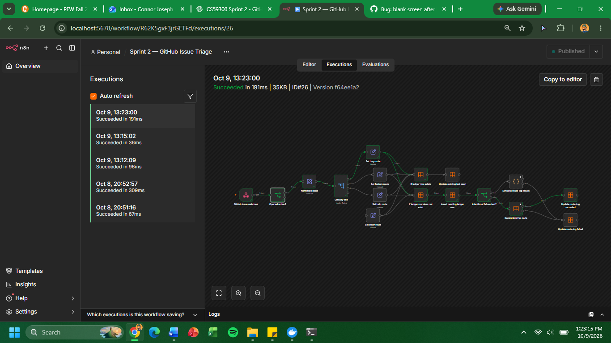

### Ledger Evidence

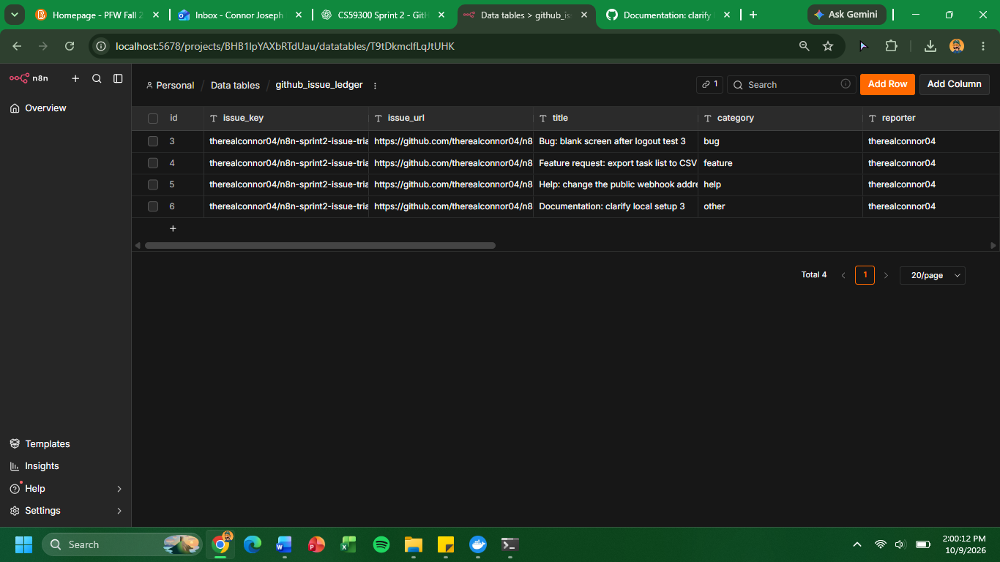

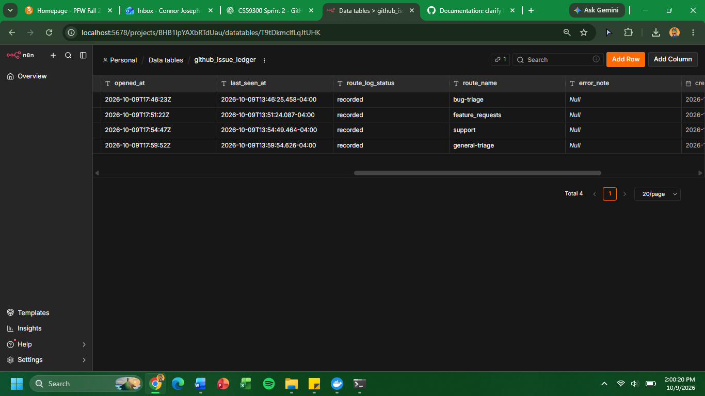

### Route-Log Evidence

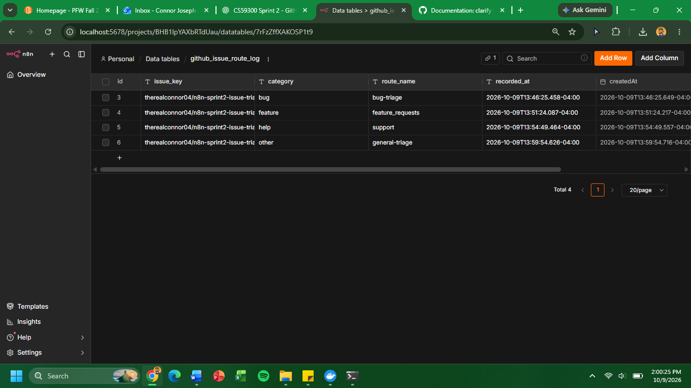

---

## Test 2 – Feature Classification

**Issue title:**  
Feature request: export task list to CSV

**Expected result:**  
- Category: `feature`
- Route name: `feature-requests`
- Ledger status: `recorded`
- One matching route-log row

**Result:**  
The workflow successfully classified the issue as a feature request and routed it to `feature-requests`. The ledger row and route-log row were both recorded successfully.

### Execution Evidence

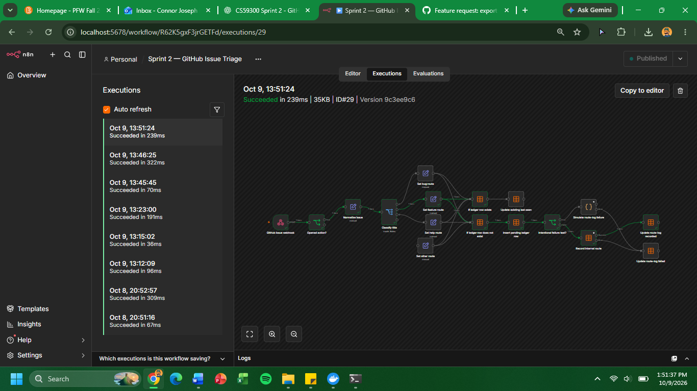

### Ledger and Route-Log Evidence

The shared ledger screenshots show the feature issue with `category = feature`, `route_name = feature-requests`, and `route_log_status = recorded`.

---

## Test 3 – Help Classification

**Issue title:**  
Help: change the public webhook address

**Expected result:**  
- Category: `help`
- Route name: `support`
- Ledger status: `recorded`
- One matching route-log row

**Result:**  
The workflow successfully classified the issue as a help request and routed it to `support`. The ledger and route-log entries were recorded successfully.

### Execution Evidence

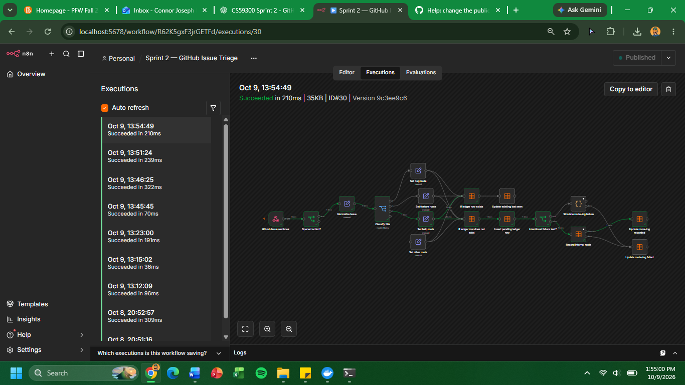

### Ledger and Route-Log Evidence

The shared ledger screenshots show the help issue with `category = help`, `route_name = support`, and `route_log_status = recorded`.

---

## Test 4 – Other/Fallback Classification

**Issue title:**  
Documentation: clarify local setup

**Expected result:**  
- Category: `other`
- Route name: `general-triage`
- Ledger status: `recorded`
- One matching route-log row

**Result:**  
The issue did not match the bug, feature, or help rules, so the fallback output correctly classified it as `other` and routed it to `general-triage`.

### Execution Evidence

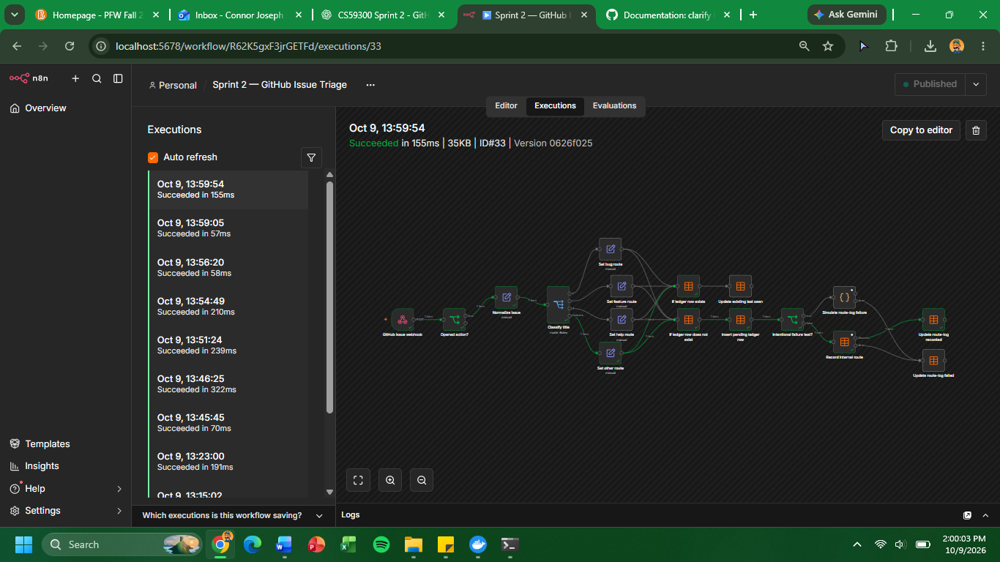

### Ledger and Route-Log Evidence

The shared ledger screenshots show the other issue with `category = other`, `route_name = general-triage`, and `route_log_status = recorded`.

---

## Opened-Action Gate Test

The body of Test 4 was edited after the issue had already been opened.

**Expected result:**  
The workflow should reject the edit event because only `opened` issue actions are allowed to continue into triage.

**Result:**  
The execution stopped at the `Opened action?` node. No new ledger row or route-log row was created.

### Evidence

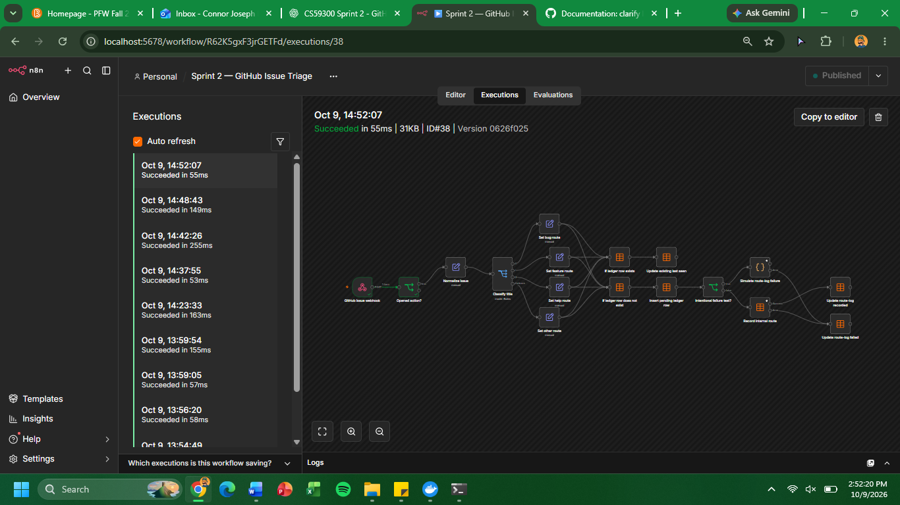

---

## Duplicate / Idempotency Test

The workflow was tested by replaying the same issue payload for an already-recorded bug issue.

**Expected result:**  
- The existing ledger row should remain the only row for that `issue_key`
- `last_seen_at` should update
- No second `bug-triage` route-log row should be created

**Result:**  
The duplicate payload followed the existing-row path and updated the previously stored issue instead of inserting another ledger record or route-log entry.

### Duplicate Execution Evidence

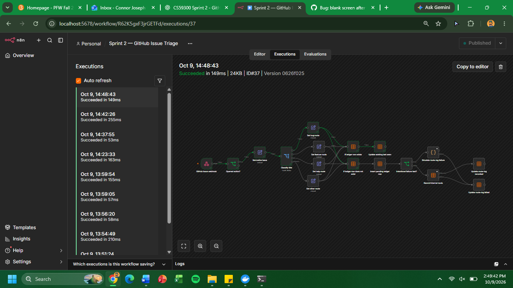

### Ledger Evidence

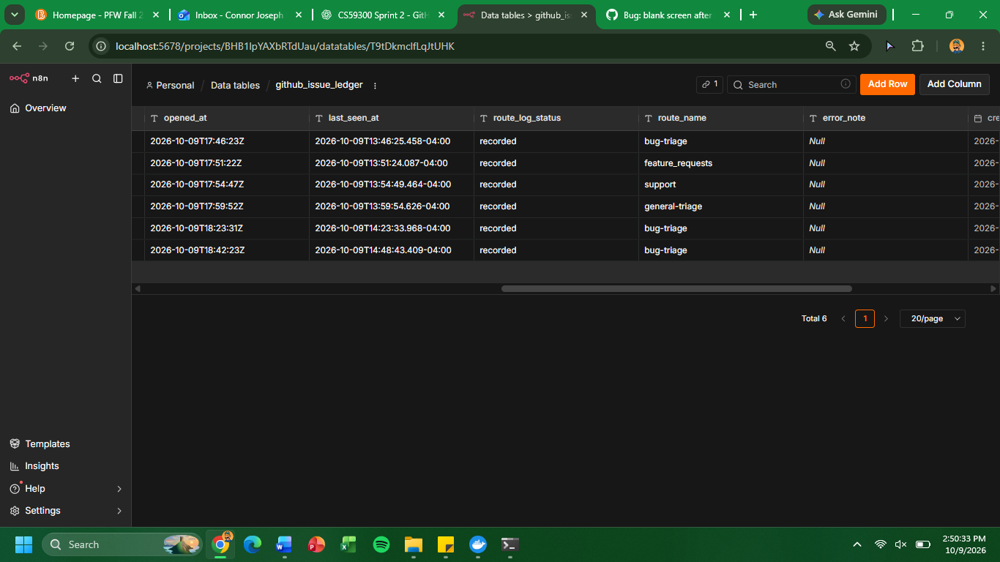

### Route-Log Evidence

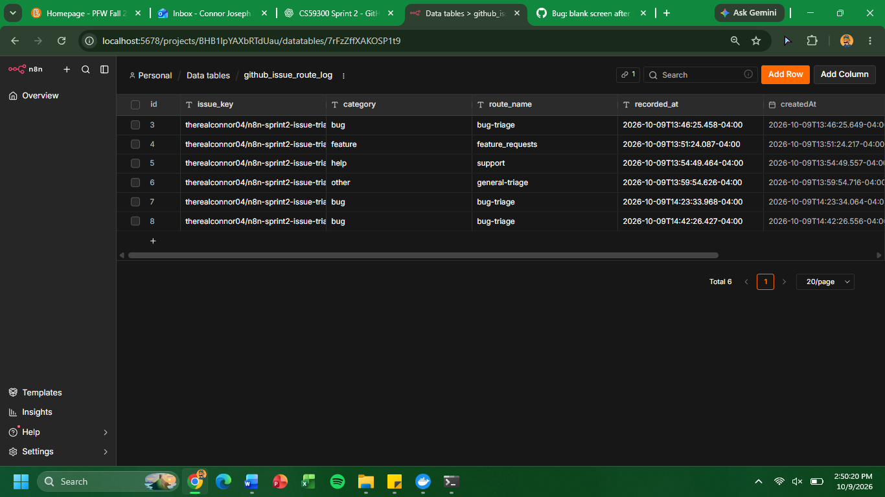

### GitHub Redelivery Note

GitHub's built-in webhook redelivery was attempted, but the GitHub CLI forwarding webhook returned `401 Unauthorized` before the request reached n8n. Because no n8n execution was created from that redelivery, the same issue payload was replayed locally against the production n8n webhook to verify the workflow's duplicate-handling logic.

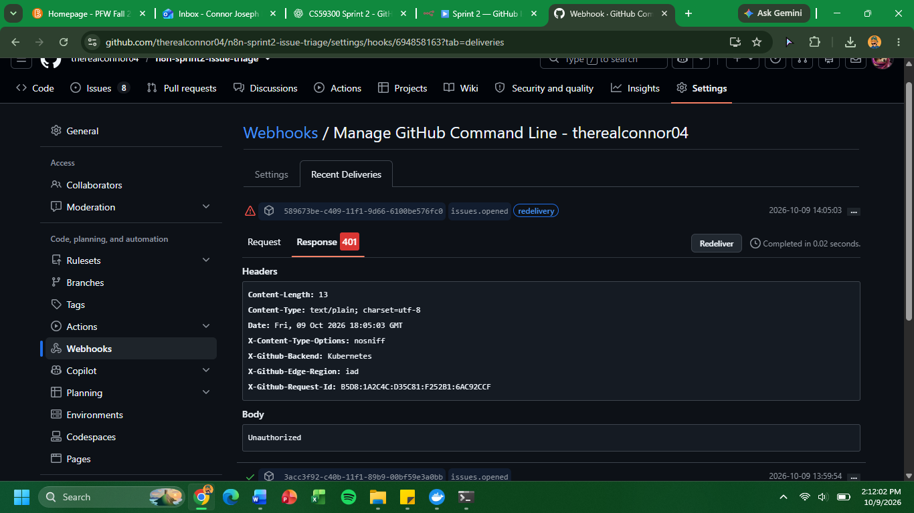

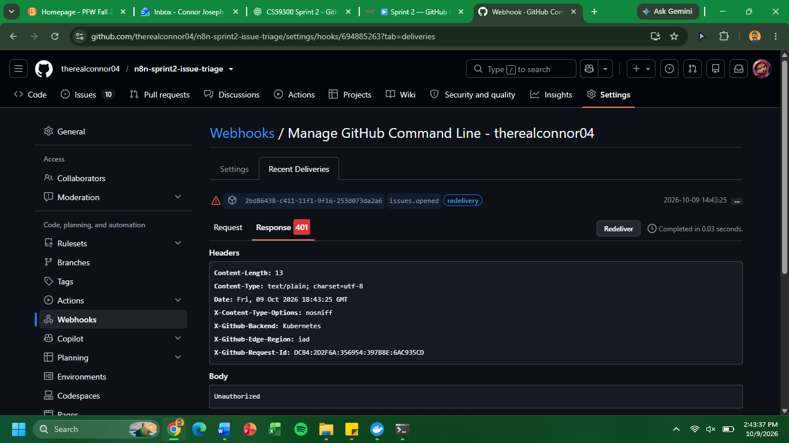

---

## Intentional Route-Log Failure Test

**Issue title:**  
Documentation: intentional route-log failure test

**Expected result:**  
- Category: `other`
- Route name: `general-triage`
- Ledger status: `failed`
- Readable `error_note`
- No route-log row for the failed issue

**Result:**  
The issue followed the intentional failure path through `Simulate route-log failure` and `Update route-log failed`. The ledger retained the issue with a failed status and readable error message, and no route-log row was created for the failed issue.

### Failure Execution Evidence

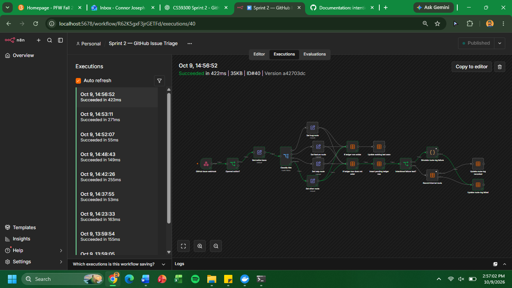

### Failed Ledger Evidence

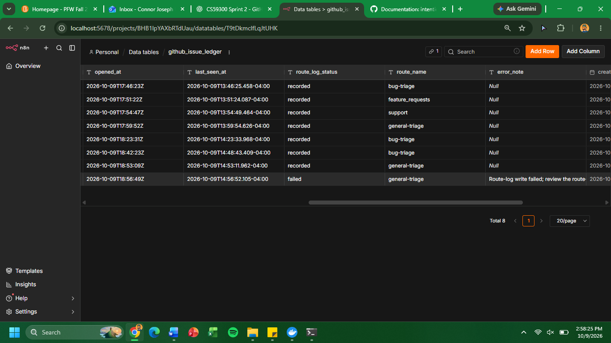

### Route-Log Evidence

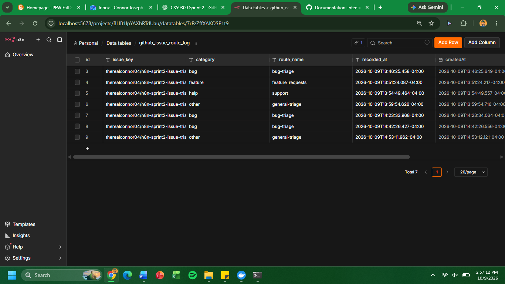

---

## Summary

The workflow successfully demonstrated:

- Deterministic classification for bug, feature, help, and other issues
- Category-specific route names
- Persistent ledger records
- Route-log recording for successful issues
- Rejection of non-opened issue actions
- Duplicate detection without duplicate route-log writes
- Explicit failure handling with a retained failed ledger record

The GitHub redelivery attempt itself returned `401 Unauthorized`, so duplicate behavior was additionally verified by replaying the same issue payload directly to the production n8n webhook.
